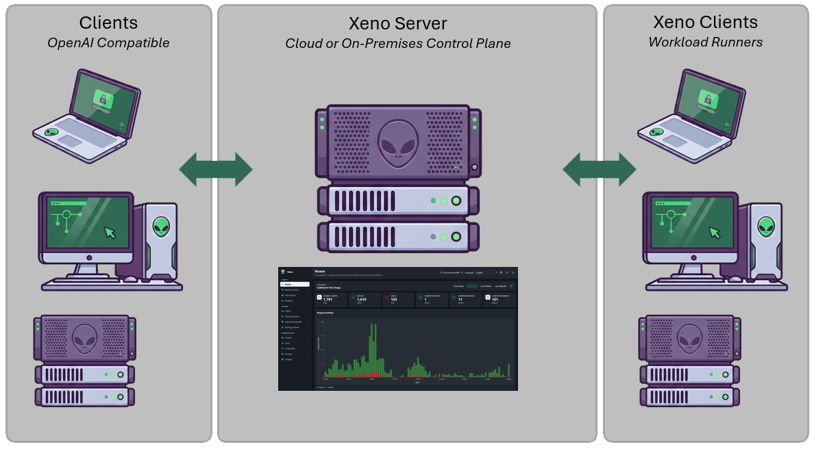
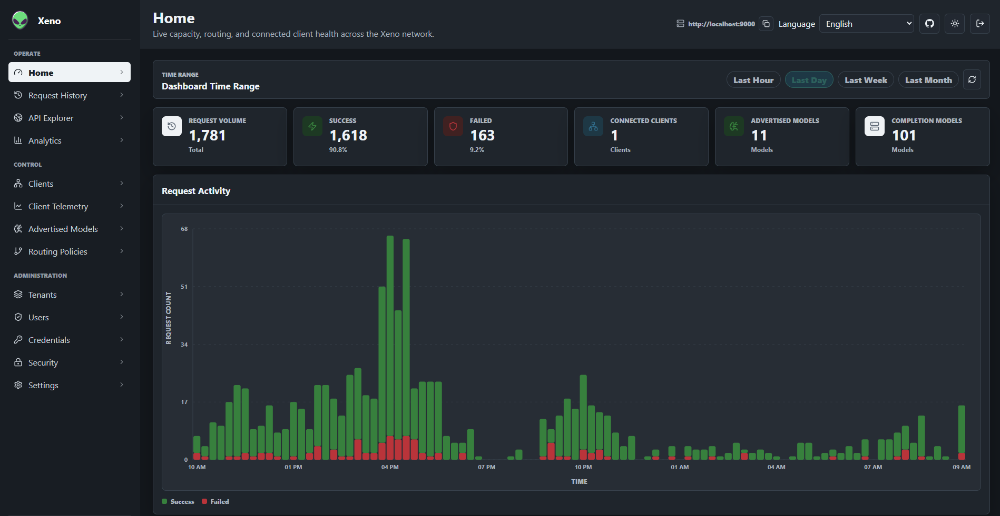
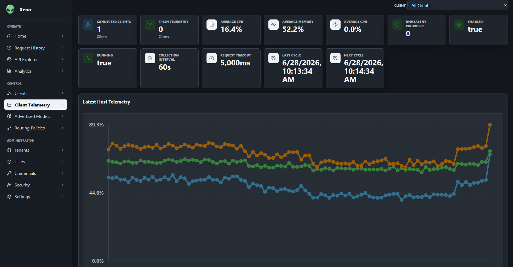
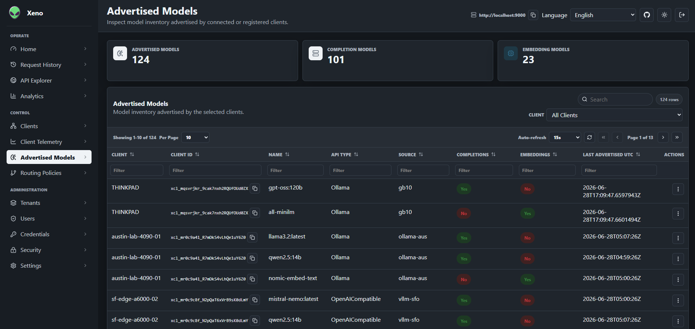
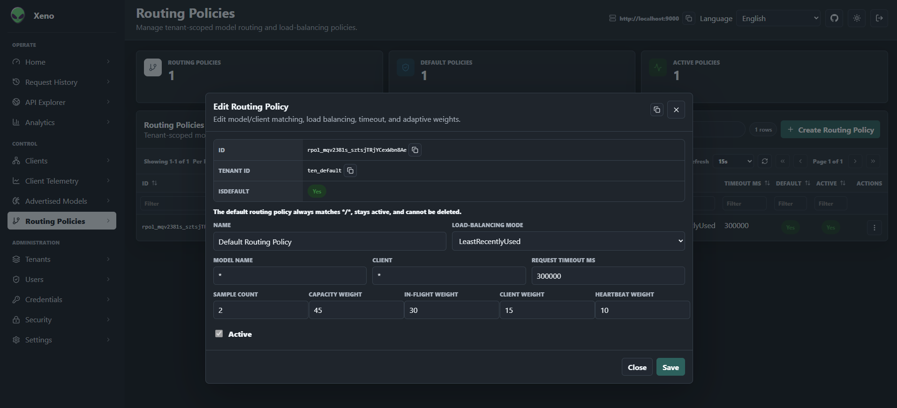
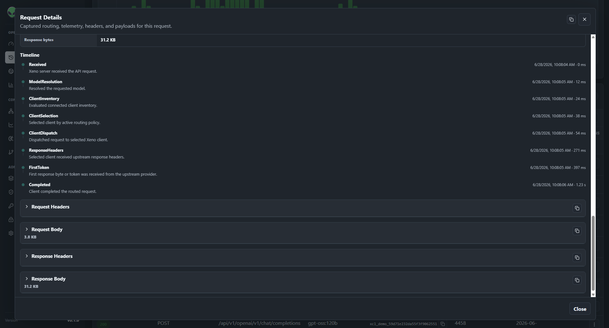

# Xeno


**Version:** v0.1.0

**Status:** ALPHA

Xeno v0.1.0 is an alpha release. APIs, configuration files, dashboard workflows, Docker deployment details, SDKs, and client commands may change before a stable release.

Xeno is an AI control plane for turning distributed computers into a shared model-serving network. A lightweight client runs on laptops, desktops, workstations, and servers, advertises the machine's available providers and models, and maintains a persistent WebSocket connection to the Xeno server. The server exposes OpenAI-compatible APIs and routes requests to connected clients that can service the selected model.

The larger goal is to make AI accelerator capacity addressable wherever it already exists. A small Xeno server can run in modest cloud infrastructure while people around the world connect machines with different GPUs, CPUs, memory sizes, provider runtimes, and model inventories. A data center administrator can use the same design inside private infrastructure: deploy a Xeno controller, run the `xeno` client as an agent on accelerator hosts, and expose those federated resources to agentic applications through one governed API endpoint.

## What Xeno Does

Xeno gives teams one place to manage and use distributed AI capacity.

- Exposes OpenAI-compatible routes for chat completions, completions, embeddings, model listing, and related workflows.
- Connects remote machines through the cross-platform `xeno` client.
- Lets clients advertise hardware, provider endpoints, and available models.
- Routes requests to connected clients through tenant-scoped routing policies with model/client match rules and load balancing modes: `RoundRobin`, `Random`, `FirstAvailable`, `LeastRecentlyUsed`, and `Adaptive`.
- Supports Ollama, OpenAI, Gemini, and OpenAI-compatible endpoints such as vLLM from the client configuration.
- Hosts an optional local client dashboard from the background `xeno` process for connection state, provider/model management, client-side request history, and machine telemetry.
- Can expose an optional localhost-only OpenAI-compatible and Ollama-compatible inference listener from the client for local apps. It is disabled by default, uses the client's configured Xeno identity, and proxies requests through the authenticated WebSocket tunnel.
- Persists local client request history in SQLite for the machine running `xeno`, including request/response headers, bounded bodies, timing, token metadata, and stream counters.
- Collects local CPU, memory, disk, and GPU telemetry on the client at a configurable interval, persists it in SQLite, and exposes live and historical telemetry dashboard pages.
- Can collect fleet-level client telemetry from the server. When `TelemetryCollection.Enabled` is true, the server requests host and provider telemetry over the authenticated client WebSocket, persists server-collected samples, and shows them under `CONTROL > Client Telemetry`.
- Provides a multitenant server with tenants, users, roles, permissions, credentials, connected clients, advertised models, request history, analytics, settings, provider-backed email notifications, and audit-friendly telemetry.
- Records request routing and response telemetry, including selected client, timing, token metadata, headers, bodies, and streaming metrics where available.
- Returns useful routing headers such as `X-Client-ID` and `X-Xeno-*` trace headers so developers can troubleshoot model calls.
- Ships with a web dashboard, REST API, OpenAPI/Swagger documentation, Postman collection, Docker deployment assets, and C#, JavaScript, and Python SDKs.

## Why Use It

Use Xeno when you want a single OpenAI-compatible endpoint backed by many machines.

- Share idle GPUs and CPUs across a local network, lab, team, or private infrastructure.
- Keep local and private model execution behind a central API.
- Mix providers without forcing application code to know where a model actually runs.
- Add authentication, multitenancy, request history, dashboard visibility, and routing policy around model execution.
- Move between local Ollama, hosted APIs, and OpenAI-compatible model servers while keeping the same application integration point.
- Debug agentic applications with response headers and request history that show which node handled a request and why it was selected.

## Platform Vision

Xeno treats model-serving capacity as a fleet instead of a single box. The server is the controller: it owns identity, tenancy, routing policy, request history, telemetry, and the public API surface. The client is the agent: it runs beside the hardware and provider runtimes, advertises what the node can do, executes routed requests locally, and reports health and telemetry back to the controller.

That split supports several deployment patterns:

- Community or contributor GPU networks: run a small server in the cloud, issue tenant-bound client credentials, and let trusted users connect machines from home labs, offices, classrooms, or partner sites. Each node can advertise only the models and provider endpoints it is willing to serve.
- Enterprise and data center accelerator federation: deploy the server as an internal controller and run `xeno` on GPU servers as an agent. Agentic applications call one OpenAI-compatible endpoint while Xeno places work on eligible hosts using model inventory, routing policy, capacity, and telemetry.
- Hybrid and burst capacity: combine local Ollama, vLLM, or OpenAI-compatible runtimes with hosted APIs such as OpenAI or Gemini. Applications keep the same integration point while operators decide where a model name should resolve.
- Lab, classroom, and research clusters: expose heterogeneous machines as one governed pool without requiring every application developer to know which workstation has which accelerator, runtime, or model.
- Edge and branch deployments: keep inference near private data or users while maintaining central visibility into connected nodes, advertised models, and request outcomes.

In these modes, Xeno is not just a proxy. It is a coordination layer for resource discovery, placement, observability, and access control around distributed model execution. The current alpha focuses on practical foundations: authenticated clients, OpenAI-compatible routing, local and server-side telemetry, dashboard operations, SDKs, and policy surfaces that can evolve toward richer accelerator scheduling.

## How It Works



1. The Xeno server starts a REST API, OpenAPI/Swagger endpoint, dashboard-facing management API, database layer, and WebSocket endpoint.
2. A user logs in through the `xeno` client. The password is used only to bootstrap a tenant-bound client credential.
3. The client stores an access key in `~/.xeno/client.json`; it does not store or use the user's password for the WebSocket connection.
4. The client connects to `/ws/v1/clients`, authenticates with its access credential, binds the registered client record to the credential's owning user, and advertises machine inventory, provider endpoints, and models.
5. Applications call the Xeno OpenAI-compatible API.
6. The server authenticates the caller, verifies tenant-scoped inference permission, resolves the tenant's effective routing policy, then selects a connected client that advertises the requested model.
7. The selected client forwards the request to its configured provider, streams or returns the response, and reports telemetry back to the server.
8. The server returns the model response to the caller and persists request history for dashboard inspection.
9. When enabled, the client also writes local request history to SQLite and exposes a local dashboard for inspecting what that specific machine processed.
10. When enabled, the client can expose `http://127.0.0.1:11434` as a local OpenAI/Ollama-compatible API surface. Requests still go through the Xeno server over the WebSocket tunnel, so server-side tenancy, routing, request history, and ledgering remain in effect.
11. When server telemetry collection is enabled, the server controls collection cadence and clients answer explicit telemetry request frames. Disabling server collection does not disable the client's local telemetry dashboard.

## Local Client Inference Listener

The Xeno client can expose a convenience API for local applications that expect either OpenAI-compatible or Ollama-compatible endpoints. The listener is disabled by default and is loopback-only; it accepts `localhost`, `127.0.0.1`, `::1`, or `[::1]` and rejects public or wildcard hosts.

Add or edit this section in `~/.xeno/client.json`:

```json
{
  "LocalInferenceServer": {
    "Enabled": true,
    "Host": "127.0.0.1",
    "Port": 11434,
    "EnableCors": true,
    "RequestTimeoutMs": 300000
  }
}
```

After `xeno start`, local apps can use:

- OpenAI base URL: `http://127.0.0.1:11434/v1`
- Ollama base URL: `http://127.0.0.1:11434/api`

Supported routes are `/v1/chat/completions`, `/v1/completions`, `/v1/embeddings`, `/v1/models`, `/v1/models/{model}`, `/api/generate`, `/api/chat`, `/api/embeddings`, `/api/embed`, `/api/tags`, `/api/show`, and `/api/ps`. `HEAD /` and `GET /` return `200 OK` with no payload for compatibility probes. `HEAD` against any supported OpenAI- or Ollama-compatible route also returns `200 OK` with no payload and does not require the WebSocket tunnel. Streaming is supported for OpenAI chat completions, OpenAI completions, and Ollama generate/chat. If the Xeno WebSocket is disconnected, severed, or unauthorized, the listener stays up but returns provider-shaped `502` responses. If a local inference request exceeds `LocalInferenceServer.RequestTimeoutMs`, the listener cancels the tunneled request and returns a provider-shaped `504` response.

## Server Client Telemetry

Server-side telemetry collection is configured with `TelemetryCollection` in `xeno.json`. The collection interval is clamped to a minimum of `10` seconds and a maximum of `300` seconds. Request timeout, retention, pruning interval, raw snapshot persistence, raw snapshot byte limit, provider metric row limit, and collection concurrency are also bounded settings.

Collected data includes normalized host metrics for CPU, memory, disk, and GPU, plus provider health, model counts, queue depth, latency, token rates, cache pressure, and normalized provider metrics where available. Xeno does not collect prompts, responses, provider credentials, authorization headers, cookies, API keys, or unbounded raw metrics as telemetry.

The server dashboard exposes the fleet view at `CONTROL > Client Telemetry`. REST clients can use `/v1.0/api/client-telemetry/status`, `/latest`, `/collect`, host/provider history search, details, deletes, collection attempts, and `/metrics`.

## Getting Started With Docker

The default Docker deployment uses PostgreSQL and starts a one-shot initialization container before the server starts.

```powershell
cd docker
docker compose pull
docker compose up -d
docker ps -a
```

Default local endpoints:

- Dashboard: `http://localhost:9100`
- Server REST API: `http://localhost:9000`
- NetLedger server: `http://localhost:8080`
- NetLedger UI: `http://localhost:9200`
- Health check: `http://localhost:9000/health`
- Ping heartbeat: `http://localhost:9000/v1.0/api/ping`
- OpenAPI JSON: `http://localhost:9000/openapi.json`
- Swagger UI: `http://localhost:9000/swagger`
- Client WebSocket: `ws://localhost:9000/ws/v1/clients`

Seeded alpha credentials:

- Dashboard/server user: `admin@xeno`
- Password: `password`
- Default client access key: `default`
- NetLedger development access key and secret: `default` / `default` in the local Docker stack. Override Xeno's NetLedger credential with `NETLEDGER_ACCESS_KEY` and `NETLEDGER_SECRET_KEY`, or `XENO_LEDGER_API_KEY` and `XENO_LEDGER_SECRET_KEY`.

The Docker images are:

- `jchristn77/xeno-server:v0.1.0`
- `jchristn77/xeno-dashboard:v0.1.0`
- `jchristn77/netledger:v3.0.0`
- `jchristn77/netledger-ui:v3.0.0`

The compose stack uses one PostgreSQL container and initializes both the `xeno` and `netledger` databases. Xeno ledger settings in [docker/xeno.json](docker/xeno.json) point at `http://netledger-server:8080`; NetLedger settings live in [docker/netledger/netledger.json](docker/netledger/netledger.json). Xeno reads `XENO_LEDGER_API_KEY`/`XENO_LEDGER_SECRET_KEY` or `NETLEDGER_ACCESS_KEY`/`NETLEDGER_SECRET_KEY` from the environment for NetLedger access-key authentication, with the documented local fallback used only for development. NetLedger image names and host ports can be overridden with `NETLEDGER_SERVER_IMAGE`, `NETLEDGER_UI_IMAGE`, `NETLEDGER_SERVER_PORT`, and `NETLEDGER_UI_PORT`.

To rebuild and push images:

```powershell
docker login
build-server.bat v0.1.0
build-dashboard.bat v0.1.0
build-all.bat v0.1.0
```

`build-all.bat` delegates to the server and dashboard build scripts and passes the requested image tag through to both.

## Getting Started From Source

Prerequisites:

- .NET SDK compatible with the solution target framework
- Node.js and npm for the dashboard
- Docker Desktop if you want to run the compose stack or publish images

Build the backend and tests:

```powershell
dotnet build src/Xeno.sln -c Release
```

Build and test the dashboard:

```powershell
cd dashboard
npm install
npm test
npm run build
```

Run the server locally:

```powershell
dotnet run --project src/Xeno.Server -- xeno.json
```

Install the client as a global `xeno` tool on Windows:

```powershell
install-tool.bat
```

Remove it later with:

```powershell
remove-tool.bat
```

## Using The Xeno Client

The client stores settings at `~/.xeno/client.json` and state at `~/.xeno/state.json`.

Log in and configure a local Ollama provider:

```powershell
xeno login -u admin@xeno --server http://localhost:9000
xeno provider add --name local-ollama --type Ollama --endpoint http://127.0.0.1:11434
xeno model add --provider local-ollama --name llama3.2:latest --type completion
xeno inventory
xeno connect
```

`xeno connect` starts a background client process and returns after the client
registers with the server. Use `xeno connect --foreground` when you want the
WebSocket loop to stay attached to the current terminal.

Useful client commands:

```powershell
xeno config show
xeno status
xeno ping
xeno ping -n 10
xeno logs -f
xeno dashboard
xeno dashboard open
xeno reload
xeno restart
xeno stop
xeno disconnect
xeno provider list
xeno provider ls
xeno provider update --name local-ollama --endpoint http://127.0.0.1:11434 --timeout 300000
xeno provider delete --name local-ollama
xeno provider rm --name local-ollama
xeno model list
xeno model ls
xeno model add --provider local-ollama --name all-minilm --type embedding
xeno model update --provider local-ollama --name llama3.2:latest --type both
xeno model delete --name llama3.2:latest
xeno model rm --name llama3.2:latest
xeno reset
xeno reset --force
```

Provider endpoint URLs and upstream API types are configured with
`xeno provider add` and `xeno provider update`; `xeno model add` and
`xeno model update` manage the models advertised under each provider. Provider
and model CLI mutations are written to `~/.xeno/client.json` and request an
inventory update when a client worker is already connected. If you edit
`~/.xeno/client.json` directly, run `xeno reload` to re-read the file and
re-advertise updated provider/model inventory on the next heartbeat. For the
full walkthrough, see the platform-specific guides in
[getting-started/](getting-started/).

### Local Client Dashboard

The `xeno` background process hosts a local dashboard for the machine running
the client by default. It defaults to `http://127.0.0.1:9343`, uses a local per-process API
token, and stores request history in SQLite at `~/.xeno/local-dashboard.db`.
The dashboard shows local connectedness, request activity, CPU/memory/disk/GPU
telemetry, provider runtime telemetry from Ollama, vLLM, and compatible
endpoints, telemetry analytics, client logs, configured provider endpoints,
advertised models, and request details for work processed by that machine.
Providers and advertised models can be created, edited, and deleted from the
browser without hand-editing `client.json`. Dashboard provider/model changes
also request a server inventory update while connected. If you do hand-edit
`client.json`, use the Settings page's reload action or run `xeno reload`.

The default settings in `~/.xeno/client.json` are:

```json
{
  "LocalDashboard": {
    "Enabled": true,
    "Host": "127.0.0.1",
    "Port": 9343
  },
  "Telemetry": {
    "Enabled": true,
    "CollectionIntervalMs": 15000,
    "RetentionDays": 30,
    "ProviderTelemetry": {
      "Enabled": true,
      "CollectionIntervalMs": 15000,
      "RequestTimeoutMs": 5000,
      "ConcurrentProviderLimit": 4,
      "DiscoverMetricsEndpoints": true,
      "PersistRawMetrics": false
    }
  }
}
```

`xeno start`, `xeno connect`, and `xeno status` print the dashboard URL when it
is listening. `xeno dashboard open` opens it in the default browser. Set
`LocalDashboard.Enabled` to `false` to disable it. Binding to
`0.0.0.0` is supported only when explicitly configured and may expose the local
dashboard beyond the client machine depending on firewall and network policy.
Host, port, token, and database filename changes are saved to the settings file
but take effect after restarting the client with `xeno restart`.

The local dashboard API is intentionally localhost-oriented and separate from
the Xeno server management API. It exposes client state, provider and model
management, local request history, host telemetry history, provider telemetry
history, request summaries, logs, settings, and local database status under
`http://127.0.0.1:9343/api/v1/...` when enabled. Provider telemetry is
best-effort: local runtimes such as Ollama and vLLM expose richer operational
metrics, while cloud providers generally expose only reachability, model
inventory, and safe response-header metadata.

## Calling The API

OpenAI-compatible routes and management routes require an authenticated caller
with permission in the selected tenant. The local source config keeps
`Rest.RequireAuthentication` set to `false` for development health/bootstrap
workflows, but protected routes still reject anonymous callers. The Docker
sample sets `Rest.RequireAuthentication` to `true`.

Create a bearer token from a tenant-bound credential:

```bash
curl http://localhost:9000/v1.0/api/auth/token \
  -H "Content-Type: application/json" \
  -H "x-tenant-guid: ten_default" \
  -d '{
    "accessKey": "default"
  }'
```

The response contains `Token`, `TokenType`, `TenantId`, `SessionId`, and
`ExpiresUtc`. Use the returned `Token` value in `Authorization: Bearer ...`.
The examples below assume:

```bash
TOKEN="paste-token-from-auth-token-response"
```

List models:

```bash
curl http://localhost:9000/v1/models \
  -H "Authorization: Bearer $TOKEN" \
  -H "x-tenant-guid: ten_default"
```

Send a chat completion:

```bash
curl http://localhost:9000/v1/chat/completions \
  -H "Authorization: Bearer $TOKEN" \
  -H "Content-Type: application/json" \
  -H "x-tenant-guid: ten_default" \
  -d '{
    "model": "llama3.2:latest",
    "messages": [
      {
        "role": "system",
        "content": "You are a helpful and concise assistant."
      },
      {
        "role": "user",
        "content": "Explain how an inverted index works."
      }
    ],
    "stream": true,
    "stream_options": {
      "include_usage": true
    },
    "max_output_tokens": 2000
  }'
```

When a streamed completion or chat request is routed through a connected client,
Xeno also requests provider usage telemetry from Ollama, OpenAI, vLLM, and
generic OpenAI-compatible endpoints. Request history captures OpenAI `usage`
token fields and normalizes Ollama-native `prompt_eval_count` and `eval_count`
into input, output, and total token telemetry.

The public `GET` and `POST`
`/v1.0/api/request-history/model-leaderboard` APIs aggregate request-history
token telemetry into a rank-ordered model leaderboard. Omitting `tenantId`
returns global model usage across tenants; supplying `tenantId` scopes the
leaderboard to that tenant. Responses are keyed by model name and include
`totalTokens`, `promptTokens`, `outputTokens`, plus a pre-pagination `total`
count for dashboard paging. `limit` and `offset` are optional integers; omit
them or send JSON `null` to use defaults.

The same bearer token is used for management APIs. Client WebSocket
connections are different: they authenticate with `x-access-key` and
`x-tenant-guid`, not bearer tokens. When a client registers, the server stores
the authenticated owner context on the client record as `ownerUserId`,
`ownerCredentialId`, and `ownerPrincipalType`; a different user in the same
tenant cannot claim that registered client ID. Use the dashboard,
Swagger UI, Postman collection, or SDK console apps to explore the full API
surface.

### Security Model

Xeno authorization has three layers:

- System admins are users with `isAdmin = true`; they can administer all tenants and can change the system-admin flag.
- Tenant admins are users with `isTenantAdmin = true`; they can administer only their own tenant and cannot change `isAdmin`.
- RBAC users and credentials receive tenant-scoped permissions through roles. A grantor cannot create permissions, roles, or role assignments that exceed their own effective authority.
- Built-in roles and seeded permissions are protected from management API mutation.

Every protected request is tenant fenced. A caller authenticated for tenant A
cannot use tenant B records unless the caller is a system admin using an
explicit cross-tenant administrative path. OpenAI-compatible requests require
`Inference.Read` for model listing and `Inference.Execute` for completions,
chat completions, and embeddings. Request history records tenant and principal
identity fields for usage reporting.

Tenant membership is one tenant per user row. The same email address may be
present in multiple tenant-specific user records; non-system-admin users switch
tenants by logging out and logging in to the desired tenant. Password login,
dashboard login, and token creation are rate limited by source IP with
`Auth.MaxLoginRequestsPerMinute` in the JSON settings file.

## Dashboard

The dashboard is the primary administration surface for Xeno. It includes:

- Home charts for request activity and connected clients.
- Connected client and advertised model views.
- Client owner context showing which user and credential authenticated the client connection.
- Routing policy management for model/client matching and load-balancing behavior.
- Request history with telemetry, headers, bodies, streaming details, and routing decisions.
- Tenant, user, credential, role, and permission create/edit/delete workflows.
- Settings management for server configuration, including email provider setup and global-admin test email sends.
- Analytics by time window, path, model, and request behavior.
- Integrated API Explorer with editable JSON request bodies, response headers, streaming previews, and copy-to-clipboard controls.

### Dashboard Screenshot Carousel

Use the linked slides below to review the primary server-dashboard surfaces.

<p align="center">
  <a href="assets/ss1.png"></a>
</p>

<p align="center">
  <a href="assets/ss1.png">Slide 1</a> ·
  <a href="assets/ss2.png">Slide 2</a> ·
  <a href="assets/ss3.png">Slide 3</a> ·
  <a href="assets/ss4.png">Slide 4</a> ·
  <a href="assets/ss5.png">Slide 5</a>
</p>

<p align="center">
  <a href="assets/ss1.png"></a>
  <a href="assets/ss2.png"></a>
  <a href="assets/ss3.png"></a>
  <a href="assets/ss4.png"></a>
  <a href="assets/ss5.png"></a>
</p>

## Configuration

The server configuration file controls REST, CORS, logging, WebSocket, database, routing, email, and other operational settings. The default local file is [xeno.json](xeno.json), and the Docker deployment uses [docker/xeno.json](docker/xeno.json).

Supported database engines:

- SQLite
- PostgreSQL
- SQL Server
- MySQL

The selected database engine stores server platform state and server-collected client telemetry, including host samples, provider samples, collection attempts, details, deletes, rollups, and tenant purge data.

The default Docker compose stack uses PostgreSQL. Optional MySQL and SQL Server services are present in [docker/compose.yaml](docker/compose.yaml) for alternate deployments.

Server email notifications are disabled by default. Set `Email.Enabled` to `true`, choose `Email.Provider`, and configure the provider-specific section such as `Email.Mailgun` to send onboarding and administrative notifications. Global administrators can use the dashboard settings page or `POST /v1.0/api/email/test` to send a test email through the configured provider using the standard Xeno email layout. Xeno never includes passwords, bearer tokens, access keys, or secret keys in notification email. Onboarding administrator notifications include non-secret request metadata such as source IP, forwarded-for, user agent, request ID, and correlation ID for operational drill-down.

## Ledgering

Ledgering records successful completion and embedding requests that report `total_tokens`. Xeno debits the requesting user's NetLedger account and credits the owner of the selected serving client by the same raw token amount. NetLedger v3.0.0 or later is required because Xeno relies on tenant-scoped accounts and searchable labels/tags. No pricing, weighting, quotas, reservations, or enforcement are active in this release.

Ledger writes run asynchronously after request history is captured. NetLedger outages do not block serving requests; failed ledger writes stay in an in-memory retry queue for the running process. A process crash can lose queued events that were not drained yet.

Tenant lifecycle changes cascade to NetLedger when ledgering is enabled. Tenant creation provisions the NetLedger tenant and any seed user accounts before the create response is considered fully provisioned unless the request explicitly allows deferred subordinate provisioning. Tenant display-name and active-state changes update the NetLedger tenant where supported; suspension preserves balances and entries while preventing new ledger writes for that tenant. Hard tenant deletion deletes the NetLedger tenant before Xeno clears local ledger links, and subordinate failures are reported instead of silently orphaning ledger data.

The dashboard `Ledger` page shows the current user's balance, visible balances and entries, queue status, and NetLedger health. System administrators can see global ledger data, tenant administrators can see their tenant, and regular users can see only their own balance and entries. Admin drain and reconcile actions are available from the dashboard and REST API.

Factory reset is destructive for ledger data. The Docker reset scripts remove compose volumes and restore both `docker/xeno.json` and `docker/netledger/netledger.json`, which deletes NetLedger balances and entries in the shared Postgres volume.

## SDKs

SDKs live under `src/sdk/`:

- C#: [src/sdk/csharp](src/sdk/csharp)
- JavaScript: [src/sdk/javascript](src/sdk/javascript)
- Python: [src/sdk/python](src/sdk/python)

Each SDK includes:

- `README.md`
- `TESTING.md`
- focused tests
- an interactive console application for exercising the SDK against a running Xeno server

## Documentation

Developer documentation:

- [REST_API.md](REST_API.md)
- [WEBSOCKETS_API.md](WEBSOCKETS_API.md)
- [MODEL_ROUTING.md](MODEL_ROUTING.md)
- [getting-started/](getting-started/)
- [CLIENT_GETTING_STARTED.md](CLIENT_GETTING_STARTED.md) (deprecated pointer)
- [CLIENT_TELEMETRY.md](CLIENT_TELEMETRY.md)
- [CHANGELOG.md](CHANGELOG.md)
- [AGENTS.md](AGENTS.md)
- [Xeno.postman_collection.json](Xeno.postman_collection.json)

Archived planning and audit documents are in [archive](archive).

## Repository Layout

```text
/
  README.md
  CHANGELOG.md
  REST_API.md
  WEBSOCKETS_API.md
  CLIENT_GETTING_STARTED.md
  CLIENT_TELEMETRY.md
  Xeno.postman_collection.json
  getting-started/
  build-all.bat
  build-server.bat
  build-dashboard.bat
  install-tool.bat
  remove-tool.bat
  assets/
  dashboard/
  docker/
  src/
```

Key directories:

- `src/` contains the C# solution, server, client, core library, tests, and SDKs.
- `dashboard/` contains the React/Vite dashboard.
- `docker/` contains compose assets, server settings, database initialization scripts, and factory reset scripts.
- `assets/` contains shared logo and icon assets.

## Testing

Run backend tests:

```powershell
dotnet build src/Xeno.sln -c Release
dotnet run --project src/Test.Automated -- --results results.json
dotnet test src/Test.Xunit
dotnet test src/Test.Nunit
```

Run dashboard tests:

```powershell
cd dashboard
npm test
npm run build
```

The test projects follow the Touchstone package pattern used by the reference applications: `Test.Shared`, `Test.Automated`, `Test.Xunit`, and `Test.Nunit`.

## Security Notes

Xeno is alpha software. Do not expose a development deployment directly to the public internet without a deliberate production hardening pass.

- Put public deployments behind TLS and a trusted reverse proxy.
- Keep `Rest.RequireAuthentication` enabled outside local development.
- Rotate seeded development credentials before real use.
- Store client access keys carefully.
- Use least-privilege inference credentials for application traffic instead of system-admin credentials.
- Avoid committing provider credentials or private endpoints.
- Use least-privilege database credentials in non-development deployments.
- Treat request body and response body capture as sensitive because prompts, completions, and embeddings input may contain private data.

## Filing Issues

File issues at the GitHub repository:

```text
https://github.com/jchristn/Xeno/issues
```

Helpful issue reports include:

- Xeno version and commit hash.
- Operating system and architecture.
- Whether the issue is in the server, dashboard, client, Docker deployment, or SDK.
- Exact command, route, or dashboard workflow that failed.
- Expected behavior and actual behavior.
- Relevant logs with secrets redacted.
- Minimal reproduction steps.

## Contributing

Contributions are welcome while Xeno is evolving through alpha.

Recommended workflow:

1. Open an issue or discussion for larger changes.
2. Create a focused branch.
3. Follow [AGENTS.md](AGENTS.md) and the style and testing requirements in `C:\code\agents\requirements` when working in this environment.
4. Keep changes scoped and include tests for behavior changes.
5. Update README, REST API docs, WebSocket docs, Postman, SDK docs, or dashboard text when behavior changes.
6. Run the relevant backend, dashboard, and SDK tests before opening a pull request.

Pull requests should describe the problem, the implementation, test coverage, and any migration or deployment impact.

## License

Xeno is licensed under the MIT License. See [LICENSE.md](LICENSE.md).
